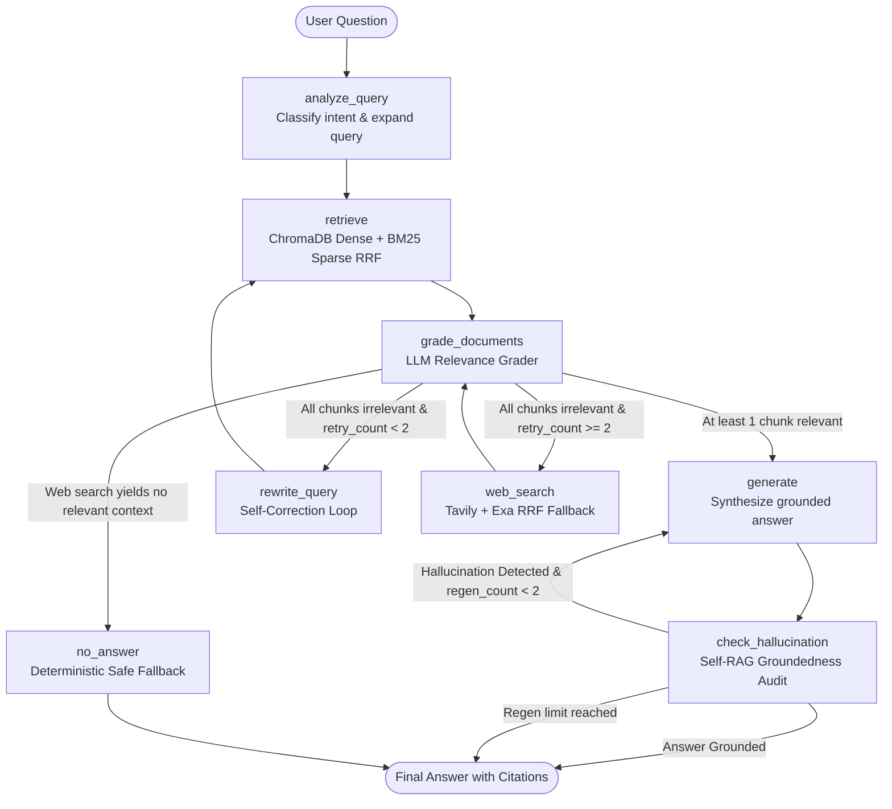
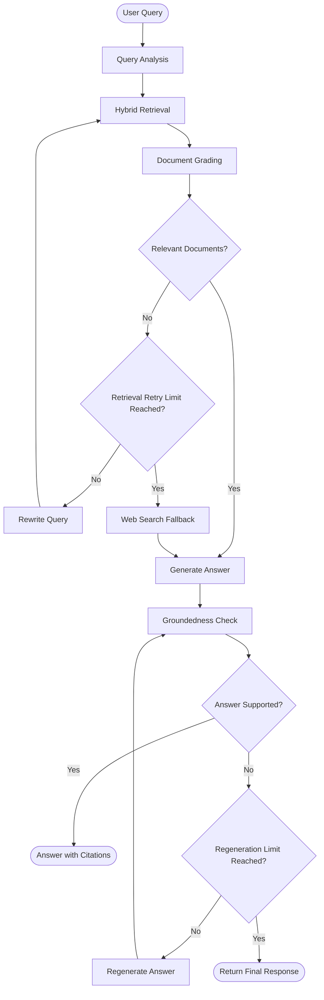

# Self-Corrective RAG Technical Documentation Assistant

A modular, production-grade documentation assistant that searches technical documents, verifies information relevance, rewrites queries upon retrieval failure, falls back to web search when context is insufficient, and generates grounded answers with source citations. 

Built using **Python, LangGraph, FastAPI, and Streamlit** as part of the **Express Analytics AI/ML Engineer Intern take-home assignment**.

[](https://www.python.org/)
[](https://fastapi.tiangolo.com/)
[](https://streamlit.io/)
[](https://docs.langchain.com/oss/python/langgraph/overview)
[](LICENSE)

---

## 1. Project Overview & Assignment Objectives

Technical software documentation is often dense, fragmented across multiple pages, and filled with exact syntactical tokens (such as `@app.get`, `field_validator`, or `add_conditional_edges`). Standard LLMs hallucinate non-existent parameters, while naive RAG pipelines fail when:
1. **Initial search queries are ambiguous or misaligned** with the indexed documentation.
2. **Retrieved chunks are irrelevant**, yet passed blindly to the generator.
3. **The local documentation corpus is insufficient** to answer the question.
4. **Generated answers make unsubstantiated claims** not grounded in the source text.

### The Assignment Objective
Build an end-to-end RAG assistant powered by a **LangGraph state machine** featuring retrieval, document grading, self-corrective query reformulation, web-search fallback, answer generation, and groundedness verification, all served through a **FastAPI backend** and an **interactive Streamlit frontend**.

---

## 2. Technical Documentation Corpus (3–5 Documents)

In accordance with the assignment scenario, this repository provides a curated corpus of 5 official technical documentation guides stored in [`Data_ingestion/raw_docs/`](Data_ingestion/raw_docs/):

| # | Document Name | File Path | Source Documentation URL | Topics Covered |
|:---:|---|---|---|---|
| **1** | **LangGraph Concepts** | `01_langgraph_concepts.md` | [langchain-ai.github.io/langgraph](https://langchain-ai.github.io/langgraph/) | `StateGraph`, nodes, edges, conditional edges, state reducers, persistence, cyclic loops |
| **2** | **FastAPI Tutorial** | `02_fastapi_tutorial.md` | [fastapi.tiangolo.com](https://fastapi.tiangolo.com/) | Path & query parameters, request bodies with Pydantic, dependency injection, async routes |
| **3** | **Pydantic V2 Guide** | `03_pydantic_v2_guide.md` | [docs.pydantic.dev](https://docs.pydantic.dev/) | `BaseModel`, `@field_validator`, model serializers, V1 to V2 migration changes |
| **4** | **LangChain RAG** | `04_langchain_rag.md` | [python.langchain.com](https://python.langchain.com/) | Document loaders, recursive text splitters, vectorstores, dense retrieval |
| **5** | **ChromaDB Guide** | `05_chromadb_guide.md` | [docs.trychroma.com](https://docs.trychroma.com/) | Collections, persistent storage, distance metrics, metadata filtering, querying |

*Note: In addition to these bundled documents, users can ingest external files (`.md`, `.txt`, `.pdf`) or live documentation URLs dynamically via the API (`POST /ingest`, `POST /ingest/url`) or the Streamlit Ingestion Manager.*

---

## 3. LangGraph Workflow Architecture

The core orchestration engine is a compiled LangGraph `StateGraph`. The workflow contains **8 distinct nodes** and **2 conditional routing edges** that govern cycle loops and fallback triggers.



### Detailed Workflow Step-by-Step
1. **Query Analysis (`analyze_query`):** Classifies query intent (conceptual, syntax, comparison) and expands technical abbreviations into a search-optimized query.
2. **Hybrid Retrieval (`retrieve`):** Simultaneously queries ChromaDB (dense semantic similarity via `all-MiniLM-L6-v2`) and BM25Okapi (sparse keyword matching). Fuses results using **Reciprocal Rank Fusion (RRF, $k=60$)**.
3. **Document Relevance Grading (`grade_documents`):** An LLM evaluates each chunk as `relevant` or `irrelevant` relative to the question, filtering noise.
4. **Self-Correction Loop (`rewrite_query`):** If zero documents pass grading and `retry_count < 2`, the query is rewritten with focused search keywords and sent back to retrieval.
5. **Web Search Fallback (`web_search`):** If local retrieval fails after 2 retries, the pipeline dispatches parallel web searches to **Tavily** and **Exa**, merges results via RRF, and feeds them back into the grader.
6. **Answer Generation (`generate`):** Synthesizes a technical explanation, code snippets, and source citations strictly using the validated context chunks.
7. **Hallucination Audit (`check_hallucination`):** Self-RAG grounding check verifies every factual assertion against context. If unsupported and `regen_count < 2`, regeneration is triggered.
8. **Safe Fallback (`no_answer`):** If neither local documentation nor web search provides sufficient evidence, the system safely declines rather than hallucinating.

---

## 4. State Schema & Node-to-Node Data Flow



The entire workflow coordinates around a centralized, typed shared state defined in [`rag_pipeline/state.py`](rag_pipeline/state.py):

```python
from typing import TypedDict, List, Optional, Annotated
import operator
from langchain_core.documents import Document

class RAGState(TypedDict):
    question: str
    query_intent: Optional[str]
    rewritten_query: Optional[str]
    documents: List[Document]
    filtered_documents: List[Document]
    document_grades: Annotated[List[str], operator.add]
    generation: Optional[str]
    retry_count: int
    web_search_needed: bool
    web_search_used: Optional[bool]
    is_grounded: Optional[bool]
    hallucination_explanation: Optional[str]
    regen_count: int
```

### State Fields Specification

| Field Name | Type | Initial Value | Mutated By Node(s) | Read By Node(s) | Purpose |
|---|---|---|---|---|---|
| `question` | `str` | Raw input | User Input | All Nodes | Original user question (immutable reference). |
| `query_intent` | `Optional[str]` | `None` | `analyze_query` | `generate`, UI | Classification tag (e.g. `concept_comparison`, `syntax_lookup`). |
| `rewritten_query` | `Optional[str]` | `None` | `analyze_query`, `rewrite_query` | `retrieve`, `web_search` | Current search query used for vector and keyword lookups. |
| `documents` | `List[Document]` | `[]` | `retrieve`, `web_search` | `grade_documents` | Candidate chunks retrieved from local storage or web fallback. |
| `filtered_documents` | `List[Document]` | `[]` | `grade_documents` | `generate`, `check_hallucination` | Whitelist of chunks graded as relevant context. |
| `document_grades` | `Annotated[List[str], operator.add]` | `[]` | `grade_documents` | Streamlit Inspector, Analytics | History of grades (`relevant`/`irrelevant`). Uses `operator.add` reducer to accumulate across retry loops without overwriting past history. |
| `generation` | `Optional[str]` | `None` | `generate`, `no_answer` | `check_hallucination`, UI | Generated answer text synthesized from context. |
| `retry_count` | `int` | `0` | `rewrite_query` | `route_after_grading` | **Tracks retrieval retries.** Incremented by `+1` on each query rewrite loop. |
| `web_search_needed`| `bool` | `False` | `grade_documents` | `route_after_grading` | Set to `True` when all chunks fail relevance grading. |
| `web_search_used` | `Optional[bool]` | `False` | `web_search` | `generate`, UI | Boolean flag tracking if external web evidence was utilized. |
| `is_grounded` | `Optional[bool]` | `None` | `check_hallucination` | `route_after_hallucination` | Groundedness audit verdict (`True` = grounded, `False` = hallucinated). |
| `hallucination_explanation` | `Optional[str]` | `None` | `check_hallucination` | Streamlit Inspector | Detailed explanation justifying the hallucination audit verdict. |
| `regen_count` | `int` | `0` | `check_hallucination` | `route_after_hallucination` | **Tracks hallucination regenerations.** Incremented by `+1` per failed audit. |

### How Retries and Loops Are Controlled
To prevent infinite cyclic loops in the state graph, the workflow implements two explicit, bounded counters:

1. **Retrieval Reformulation Loop (`retry_count`):**
   - When `grade_documents` finds zero relevant chunks, `route_after_grading` inspects `state["retry_count"]`.
   - If `retry_count < 2`: routes to `rewrite_query`, which increments `retry_count = state["retry_count"] + 1` and loops back to `retrieve`.
   - If `retry_count >= 2`: the system transitions to `web_search` fallback (or `no_answer` if web search is disabled).
2. **Hallucination Regeneration Loop (`regen_count`):**
   - When `check_hallucination` determines an answer contains unsubstantiated claims, `route_after_hallucination` checks `state["regen_count"]`.
   - If `regen_count < 2`: increments `regen_count` and routes back to `generate` with a stricter grounding instruction.
   - If `regen_count >= 2`: terminates at `END` to guarantee deterministic completion latency.

---

## 5. Technology Stack

| Component | Technology | Rationale & Selection Criteria |
|---|---|---|
| **Graph Orchestration** | LangGraph & LangChain 1.4+ | Enables stateful cyclic graphs with conditional branching and explicit state schemas. |
| **LLM Inference** | Groq LPU Cloud (`qwen/qwen3.8-27b`) | Sub-second inference (~300 tokens/sec) for multi-node evaluation, grading, and generation. |
| **Dense Embeddings** | `sentence-transformers/all-MiniLM-L6-v2` | Local, zero-cost, 384-dimensional dense semantic representations running on CPU. |
| **Vector Store** | ChromaDB (Persistent SQLite + HNSW) | Local on-disk persistence for document embeddings and metadata filtering. |
| **Lexical Search** | BM25Okapi (`rank-bm25`) | Inverted index for exact code symbol, parameter, and decorator preservation. |
| **Rank Fusion** | Reciprocal Rank Fusion (RRF, $k=60$) | Mathematically merges dense cosine distances with sparse BM25 scores without calibration. |
| **Web Fallback** | Tavily Search + Exa AI Search | Dual-engine fallback: Tavily for documentation and Exa for neural semantic web discovery. |
| **Backend REST API** | FastAPI + Uvicorn | High-performance asynchronous API with Pydantic validation and Swagger/OpenAPI docs. |
| **Frontend UI** | Streamlit | Real-time multi-node execution visualizer, inspection drawers, and corpus manager. |

---

## 6. Getting Started & Setup Instructions

### 1. Prerequisites
- **Python 3.10+**
- Git
- Free API keys from:
  - [Groq Console](https://console.groq.com) (Required for LLM nodes)
  - [Tavily](https://tavily.com) & [Exa](https://exa.ai) (Optional, for web search fallback)

### 2. Clone the Repository
```bash
git clone https://github.com/sujithvaishnav/EA_Assignment.git
cd EA_Assignment
```

### 3. Create & Activate Virtual Environment
**Windows (PowerShell):**
```powershell
python -m venv venv
.\venv\Scripts\Activate.ps1
```
**Linux / macOS:**
```bash
python3 -m venv venv
source venv/bin/activate
```

### 4. Install Dependencies
```bash
python -m pip install --upgrade pip
pip install -r requirements.txt
```

### 5. Configure Environment Variables
Copy `.env.example` to create your local `.env` file:
```bash
cp .env.example .env
```
Populate `.env` with your API keys:
```ini
# Required: Groq LLM Inference
GROQ_API_KEY="gsk_your_groq_api_key_here"
GROQ_MODEL="qwen/qwen3.8-27b"

# Optional: Web Search Fallback (Tavily & Exa)
TAVILY_API_KEY="tvly-your_tavily_key_here"
EXA_API_KEY="your_exa_api_key_here"
SERPER_API_KEY="your_serper_api_key_here"
```

### 6. Build the Document Index
Run the ingestion pipeline to parse the 5 bundled markdown guides in `Data_ingestion/raw_docs/`, compute two-pass chunks, generate embeddings, and build the ChromaDB and BM25 indices:
```bash
python -m Data_ingestion.ingest
```

---

## 7. How to Run the Application

### Option A: Run All Services Together (Recommended)
Launch both the **FastAPI Backend (port 8000)** and the **Streamlit Web UI (port 8501)** simultaneously with a single command:
```powershell
python run_all.py
```
- **Streamlit Web Dashboard:** [http://localhost:8501](http://localhost:8501)
- **FastAPI Interactive Swagger Docs:** [http://localhost:8000/docs](http://localhost:8000/docs)
- **FastAPI ReDoc:** [http://localhost:8000/redoc](http://localhost:8000/redoc)

### Option B: Run Services Separately
1. **Start the FastAPI Backend:**
   ```bash
   uvicorn api.main:app --host 0.0.0.0 --port 8000 --reload
   ```
2. **Start the Streamlit Web Application:**
   ```bash
   streamlit run streamlit_app.py --server.port 8501
   ```
3. **Run the Interactive Terminal CLI:**
   ```bash
   python interactive_cli.py
   ```
4. **Run a Single Pipeline Query Test:**
   ```bash
   python run_pipeline.py
   ```

---

## 8. API Endpoints & Request/Response Examples

The FastAPI backend exposes comprehensive endpoints for RAG querying, corpus management, and health telemetry:

### 1. Query the Assistant (`POST /query`)
Executes the full LangGraph self-corrective pipeline.

**Request:**
```bash
curl -X POST "http://localhost:8000/query" \
  -H "Content-Type: application/json" \
  -d '{"question": "How do conditional edges work in LangGraph and what do they return?"}'
```

**Response (`200 OK`):**
```json
{
  "query_id": "8f7e2a91-4c12-4d3a-b892-91a0c7e2b104",
  "question": "How do conditional edges work in LangGraph and what do they return?",
  "query_intent": "concept_implementation",
  "answer": "In LangGraph, conditional edges enable dynamic routing between nodes based on the current state. They are defined using `workflow.add_conditional_edges(source_node, routing_function, path_map)`. The routing function inspects the state and returns a string key corresponding to one of the target nodes in the path map.",
  "citations": [
    {
      "source": "01_langgraph_concepts.md",
      "section": "StateGraph > Conditional Edges",
      "preview": "Conditional edges route execution based on dynamic outputs of a decision function..."
    }
  ],
  "latency_seconds": 1.34,
  "web_search_used": false,
  "is_grounded": true
}
```

### 2. Ingest Document via File Upload (`POST /ingest`)
Uploads `.md`, `.txt`, or `.pdf` technical documentation.
```bash
curl -X POST "http://localhost:8000/ingest" \
  -F "file=@my_api_doc.md" \
  -F "document_name=Custom API Reference"
```

### 3. Ingest Documentation by URL (`POST /ingest/url`)
Scrapes HTML documentation, strips boilerplate, chunks, and persists to ChromaDB.
```bash
curl -X POST "http://localhost:8000/ingest/url" \
  -H "Content-Type: application/json" \
  -d '{"url": "https://fastapi.tiangolo.com/tutorial/path-params/", "document_name": "FastAPI Path Params"}'
```

### 4. Corpus Catalog & Document Deletion
- **List Indexed Documents:** `GET /documents`
- **Delete Document Chunks:** `DELETE /documents/{document_name}`

### 5. Health & Topology Diagnostics
- **Check System Health:** `GET /health` (Returns Chroma connection, total chunks, and Groq status)
- **Workflow Topology:** `GET /graph/topology` (Returns Mermaid workflow string and node list)

---

## 9. Streamlit Dashboard Multi-View Navigation

The Streamlit UI provides three dedicated operational views via the sidebar:

1. **🔎 RAG Assistant & Inspector:**
   - Submit technical queries or select presets.
   - Real-time collapsible execution trace showing node-by-node updates.
   - Tabs for **Execution Summary**, **Retrieved Local Chunks** (with RRF scores), **Web Search Fallback**, and **Hallucination Audit**.
   - Built-in interactive user feedback rating (Thumbs Up / Thumbs Down + comments).
2. **📥 Data Ingestion & Corpus Management:**
   - Drag-and-drop file uploader (`.md`, `.txt`, `.pdf`).
   - Web URL documentation scraper with sample quick-test links.
   - Searchable catalog of all indexed documents with sample section hierarchies.
   - Single-click document deletion with automated BM25 index rebuilding.
3. **🏥 API Health & Architecture:**
   - Live telemetry status of FastAPI server and ChromaDB.
   - Embedded interactive Mermaid LangGraph workflow diagram.

---

## 10. Design Decisions & Trade-Offs

| Decision | Alternative Considered | Rationale & Trade-Off |
|---|---|---|
| **Hybrid Search (Dense + BM25 via RRF)** | Dense Vector Search Only | Technical docs contain exact programming tokens (`@field_validator`, `/items/{id}`) that dense vectors often dilute. BM25 preserves exact matches; dense embeddings capture conceptual synonyms. Reciprocal Rank Fusion ($k=60$) merges their rankings robustly without score calibration. |
| **LangGraph Cyclic StateGraph** | Linear RAG Chain (LangChain / LlamaIndex) | Ambiguous questions fail on initial retrieval. LangGraph allows cyclical self-correction (`grade_documents` ➔ `rewrite_query` ➔ `retrieve`), falling back to web search only after retries are exhausted. |
| **Two-Pass Header-Aware Chunking** | Fixed Character Splitting (e.g. 1000 chars) | Fixed splitting breaks code blocks in half and loses section headings. Pass 1 splits by Markdown headers (`#`, `##`, `###`) to preserve hierarchical context; Pass 2 splits text into 800-char chunks with 150-char overlap respecting code fences. |
| **Groq LPU Inference** | Local Ollama / OpenAI API | Technical documentation assistance demands sub-second interactive speed. Groq provides ~200–500 tokens/sec at low cost, making multi-node verification loops viable in under 2 seconds. |
| **Dual Web Fallback (Tavily + Exa RRF)** | Single Google/DuckDuckGo Scraper | Generic scrapers return ads, cookie banners, or login walls. Tavily specializes in raw technical documentation, while Exa provides semantic neural search. Fusing them ensures high-quality out-of-domain answers. |
| **Dedicated Groundedness Audit** | Unchecked LLM Generation | Unverified generative answers risk hallucinating code parameters. The `check_hallucination` node verifies assertions against retrieved chunks, with bounded regeneration (max 2) for safety. |

---

## 11. Project Directory Structure

```text
EA_Assignment/
├── Data_ingestion/
│   ├── raw_docs/              # 5 bundled technical documentation markdown files
│   │   ├── 01_langgraph_concepts.md
│   │   ├── 02_fastapi_tutorial.md
│   │   ├── 03_pydantic_v2_guide.md
│   │   ├── 04_langchain_rag.md
│   │   └── 05_chromadb_guide.md
│   ├── chroma_db/             # Local ChromaDB persistent vector database
│   ├── ingest.py              # Ingestion pipeline (two-pass chunking & embedding)
│   ├── evaluate_retrieval.py  # Retrieval benchmarking utility
│   └── feedback.json          # Persistent user feedback audit log
├── api/
│   ├── routers/               # FastAPI route controllers
│   │   ├── query.py           # POST /query
│   │   ├── documents.py       # POST /ingest, GET /documents, DELETE /documents
│   │   ├── health.py          # GET /health, GET /graph/topology
│   │   └── feedback.py        # POST /feedback, GET /feedback
│   ├── services/              # Business logic & ingestion helpers
│   ├── schemas.py             # Pydantic request/response schemas
│   └── main.py                # FastAPI entry point & CORS configuration
├── rag_pipeline/
│   ├── nodes/                 # LangGraph node implementations
│   │   ├── query_analysis.py  # analyze_query node
│   │   ├── retrieve.py        # retrieve node (Hybrid ChromaDB + BM25 RRF)
│   │   ├── grade_documents.py # grade_documents node & routing logic
│   │   ├── rewrite_query.py   # rewrite_query node (Self-correction)
│   │   ├── web_search.py      # web_search fallback node (Tavily + Exa RRF)
│   │   ├── generate.py        # generate node (Answer synthesis & citations)
│   │   └── hallucination_check.py # check_hallucination node (Self-RAG audit)
│   ├── state.py               # Shared RAGState TypedDict definition
│   └── graph.py               # Compiled StateGraph workflow definition
├── streamlit_app.py           # Interactive multi-view Streamlit UI
├── interactive_cli.py         # Terminal CLI with execution inspector
├── run_pipeline.py            # Headless pipeline query runner
├── run_all.py                 # Launches FastAPI and Streamlit concurrently
├── requirements.txt           # Python package dependencies
├── .env.example               # Environment variables template
├── LICENSE                    # MIT License
└── README.md                  # Project documentation
```

---

## 12. License

This project is licensed under the **MIT License** — see the [LICENSE](LICENSE) file for details.
